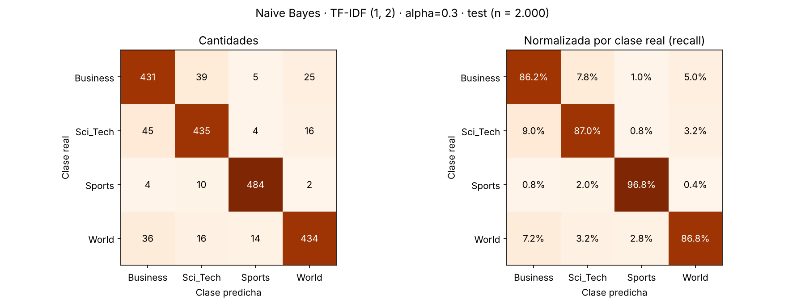
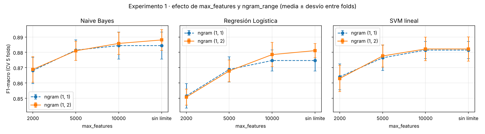

# DS III · Pre-entrega 3 — Clasificador supervisado con TF-IDF

Proyecto integrador de **Data Science III: NLP & Deep Learning aplicado a Ciencia de Datos** (Coderhouse).
Autora: **Elizabeth Luque**

Pipeline completo de clasificación de noticias **AG News** (4 clases), del texto crudo a la predicción: preprocesamiento del Módulo 2 → vectorización TF-IDF → clasificador → evaluación. Este baseline es la referencia que el Transformer del Módulo 4 tendrá que superar.

## Resultado

| | F1-macro | Accuracy |
|---|---|---|
| Validación cruzada (5 folds, solo train) | 0,8885 ± 0,006 | 0,8888 |
| **Test (evaluación única)** | **0,892** | **0,892** |
| Clasificador trivial (siempre la misma clase) | 0,100 | 0,250 |

**Modelo final:** `TfidfVectorizer(ngram_range=(1, 2), min_df=2, max_df=0.95, sublinear_tf=True)` + `MultinomialNB(alpha=0.3)`.



## Estructura del repositorio

```
ds3-clasificador-tfidf/
├── data/
│   ├── cargar_dataset.py          # loader provisto por la cátedra (sin modificar)
│   └── ag_news/                   # splits originales: ag_news_train.csv (8.000) y ag_news_test.csv (2.000)
├── src/
│   ├── text_preprocessing.py      # preprocesamiento del Módulo 2 (regex + spaCy), reutilizado tal cual
│   └── train_baseline.py          # carga, TF-IDF, experimentos con CV, entrenamiento final y evaluación
├── notebooks/
│   └── 03_clasificador_tfidf.ipynb  # recorrido completo, con todas las celdas ejecutadas y sus salidas
├── reports/
│   ├── experimentos_cv.csv        # experimento 1: modelo × ngram_range × max_features
│   ├── regularizacion_cv.csv      # experimento 2: alpha / C de cada modelo
│   ├── resumen.json               # configuración elegida y métricas en test
│   └── figures/                   # matriz de confusión y curvas de experimentación
├── requirements.txt
└── README.md
```

## Cómo ejecutarlo

```bash
python -m venv .venv && source .venv/bin/activate      # Windows: .venv\Scripts\activate
pip install -r requirements.txt
python -m spacy download en_core_web_sm
python -m src.train_baseline                            # ~1 minuto: preprocesa, experimenta, entrena y evalúa
```

También se puede abrir `notebooks/03_clasificador_tfidf.ipynb` y ejecutar todas las celdas (en Colab, la primera celda clona el repo).

## Pipeline y prevención de data leakage

1. **Carga:** `data/cargar_dataset.py` de la cátedra, con los splits originales. Se validó que no hay nulos ni duplicados y que **ningún texto de test aparece en train**.
2. **Preprocesamiento (Módulo 2):** limpieza regex (HTML escapado, entidades `#39;`, URLs, firmas de agencia, datelines), `US` → `U.S.`, minúsculas, lematización con spaCy, y quita las stop-words **conservando las negaciones**.
3. **Vectorización + modelo dentro de un `sklearn.Pipeline`:** el `TfidfVectorizer` hace `fit_transform` **solo con train** y `transform` con test. En la validación cruzada pasa lo mismo dentro de cada fold. Comprobado en el notebook: de los 1.943 términos que aparecen solo en test, **ninguno** quedó en el vocabulario.
4. **Selección con CV estratificada de 5 folds sobre train.** El test se usó **una sola vez**, al final.

## Parámetros del vectorizador

| Parámetro | Valor | Por qué |
|---|---|---|
| `ngram_range` | **(1, 2)** · explorado | los bigramas capturan entidades y frases (`oil price`, `prime minister`, `red sox`): +0,1 a +0,6 puntos de F1 según el modelo |
| `max_features` | **sin límite** (25.780 términos) · explorado | limitar a 2.000 cuesta entre 1,8 y 2,9 puntos; con 10.000 casi no hay diferencia. El ruido ya lo filtra `min_df` |
| `min_df` | 2 | descarta términos que aparecen en un solo documento (typos, nombres únicos) |
| `max_df` | 0,95 | descarta términos presentes en casi todos los documentos |
| `sublinear_tf` | True | 1 + log(tf): una palabra repetida en la misma noticia no domina |
| `norm` | l2 | cada documento sobre la hiperesfera unitaria, sin sesgo por longitud |
| `token_pattern` / `lowercase` | `\S+` / False | el texto ya viene tokenizado y en minúsculas por el pipeline de spaCy |

**Experimento 1** (`reports/experimentos_cv.csv`): 3 modelos × 2 `ngram_range` × 4 `max_features` (2.000 / 5.000 / 10.000 / sin límite) = 24 configuraciones con CV de 5 folds.



## ¿Por qué Naive Bayes?

Después de ajustar la regularización de cada modelo con su mejor vectorizador (experimento 2):

| Modelo | Mejor hiperparámetro | F1-macro CV | Entrenamiento |
|---|---|---|---|
| **Multinomial Naive Bayes** | alpha = 0,3 | **0,8885 ± 0,006** | 0,4 s |
| SVM lineal (LinearSVC) | C = 0,25 | 0,8848 ± 0,008 | 0,5 s |
| Regresión Logística | C = 1 | 0,8823 ± 0,009 | 0,7 s |

- Es el **mejor en CV**. La diferencia con SVM y Regresión Logística es menor a un desvío entre folds, así que los tres son estadísticamente equivalentes, y **a igualdad de desempeño elegimos el más simple y rápido**: Naive Bayes entrena en una sola pasada contando frecuencias, sin optimización iterativa.
- Se adapta bien a **documentos cortos** (mediana de 37 tokens en AG News).
- Es **interpretable**: `feature_log_prob_` muestra los términos que pesan en cada clase (`nasa`, `linux` → Sci_Tech; `oil price`, `treasury` → Business; `quarterback`, `nfl` → Sports; `gaza`, `troop` → World).
- **SVM lineal** queda como alternativa prácticamente empatada.

## ¿Aporta el preprocesamiento del Módulo 2?

Con el mismo modelo, el texto crudo da un F1 apenas mayor (0,8906 vs. 0,8885, dentro de un desvío). Pero sus términos más distintivos de Business son **fragmentos de URL** (`fullquote`, `investor reuters`, `aspx ticker`), y la agencia funciona como pista de la clase (AFP es 74% World, AP solo 3% Business). Es *shortcut learning*: el modelo aprende quién escribió el cable y no de qué trata la noticia. Con el pipeline del Módulo 2 se obtiene **el mismo desempeño con 42% menos vocabulario** (25.780 vs. 44.194 términos), y el modelo aprende del contenido real.

## Análisis preliminar: ¿qué categorías son más difíciles?

| Clase | Precision | Recall | F1 |
|---|---|---|---|
| Business | 0,835 | 0,862 | **0,848** |
| Sci_Tech | 0,870 | 0,870 | 0,870 |
| World | 0,910 | 0,868 | 0,888 |
| Sports | 0,955 | 0,968 | **0,961** |

- **Business ↔ Sci_Tech es la confusión principal:** 45 noticias de Sci_Tech se predicen como Business (9%) y 39 en sentido inverso (7,8%). Son noticias de empresas tecnológicas (la oferta de Oracle por PeopleSoft, Symantec comprando Veritas) que comparten vocabulario de ambas clases.
- **World → Business (7,2%):** economía internacional (petróleo, comercio, resultados de empresas extranjeras) etiquetada como World.
- **Sports es la clase más fácil** (recall 96,8%), por su vocabulario casi exclusivo.
- Son errores de **contexto, no de ruido**: una bolsa de palabras no distingue si una noticia sobre Microsoft habla del producto o de sus resultados. Es la limitación que debería resolver el Transformer del Módulo 4.

## Versiones

Python 3.13 · scikit-learn 1.9.1 · pandas 3.0.5 · numpy 2.5.3 · scipy 1.18.1 · spaCy 3.8.18 (`en_core_web_sm` 3.8.0) · matplotlib 3.11.2. Semilla: 42.
